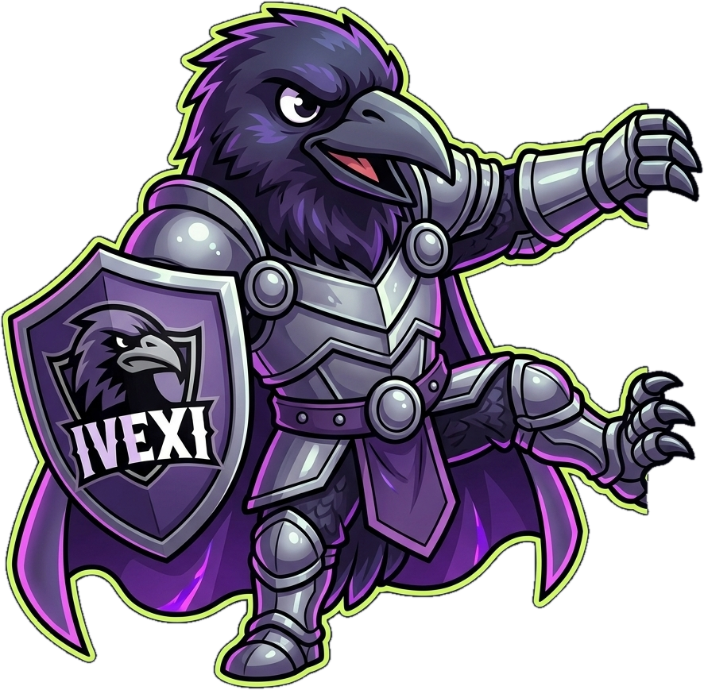
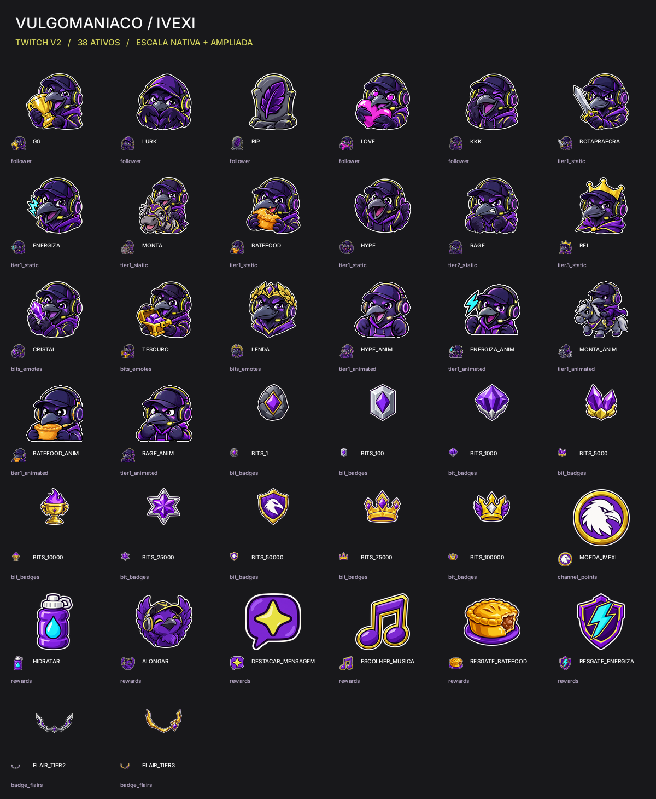

# Guia da Marca: IVEXI

Este guia centraliza a estratégia, a voz e o sistema visual da IVEXI, guilda de Albion Online.

## 1. Essência e Estratégia
A IVEXI é uma guilda de Albion Online (Servidor Américas) que oferece uma infraestrutura completa (QG 5, sem taxas) para a evolução dos jogadores. Nossa transformação é tirar o jogador do ambiente frio, tóxico e puramente mecânico das guildas competitivas, levando-o para um lugar onde a **comunidade e o acolhimento** caminham junto com a **seriedade e a violência no PVP**.

## 2. Propósito, Missão, Visão e Valores

*   **Propósito:** Quebrar a frieza do cenário competitivo de Albion, provando que uma verdadeira irmandade luta melhor do que um grupo de mercenários.
*   **Missão:** Organizar um ambiente acolhedor e focado no crescimento do jogador, com zero taxas e máxima infraestrutura, exigindo em troca apenas a lealdade diária no CTA da Blackzone.
*   **Visão:** Ser reconhecida em toda a Blackzone como a guilda que une diversão (alegria) e letalidade (caos), sendo o destino final para quem cansou das guildas grandes e frias.

### A Linha Vermelha (Valores Inegociáveis)
1. **Alegria e Caos (Ousadia e Humor)**
   - *Prática:* Resenha, humor e festa fora do CTA.
   - *Incompatível:* Arrogância e toxicidade com membros novatos.
2. **Compromisso com o Bando (Foco e Lealdade)**
   - *Prática:* Presença e obediência total na call do CTA diário (20h30).
   - *Incompatível:* Ghosting, fuga ou desrespeito à organização.
3. **Evolução Coletiva (A Irmandade Acima do Indivíduo)**
   - *Prática:* Ensinar mecânicas, fortalecer a economia do grupo e apoiar a evolução.
   - *Incompatível:* Agir de forma egoísta ou parasita, quebrando a confiança do grupo.

## 3. Público e Posicionamento
*   **O Público:** Jogadores de PVP que buscam ação, mas estão frustrados com a frieza das guildas de ZvZ padrão.
*   **A Promessa:** A união perfeita entre um ambiente competitivo e uma comunidade calorosa e parceira.
*   **As Provas:** O modelo econômico (0% de taxa), infraestrutura (QG 5) e CTA constante.

## 4. Personalidade e Voz
A personalidade da IVEXI é Ousada, Competitiva e Divertida.

*   **Pessoa Gramatical:** 1ª pessoa do plural (Nós lutamos, nós ensinamos).
*   **Grau de Formalidade:** 100% informal, linguagem gamer.
*   **Mensagem Principal:** *A IVEXI quebra a frieza do Albion com pancadaria organizada e comunidade.*
*   **Princípios:**
    1. Ousada, mas não tóxica (Alegria e Caos)
    2. Focada, mas não fria (Pancadaria Organizada)
    3. Acolhedora, mas não babá (Evolução Coletiva)

> 📖 *Para conferir os exemplos completos, matriz de canais e dicionário proibido, consulte o [Guia de Voz e Tom](brand/voice.md).*

## 5. Sistema de Logo e Ativos Oficiais
O sistema visual da IVEXI carrega o peso e o mistério da figura do Corvo, atrelado à cor Roxa.

### Ativos Principais:
*   **Emblema Oficial (O Escudo da Guilda):**
    
*   **Logotipo (Wordmark):**
    
*   **Ícone (Para aplicações compactas/Discord):**
    
*   **Mascote Oficial (Corvo Chibi Guerreiro):**
    
    *O guerreiro Chibi em armadura de cavaleiro Albion, portando o escudo com o brasão oficial da IVEXI e acabamento Caos Neon (`brand/mascote/`).*

### Sistema de Logotipo do Streamer Oficial (VulgoManiaco)
A identidade do canal parceiro/streamer da guilda integra o mascote **Corvo Streamer Chibi** com o brasão oficial IVEXI no boné e o pedestal tipográfico tático:
*   **Logotipo Badge Oficial (Escudo Tático Vertical):** `brand/logo/png/streamer-vulgomaniaco-badge-dark-master.png` (Master 1200x1350) e `brand/logo/svg/streamer-vulgomaniaco-badge-dark.svg`
*   **Logotipo Horizontal (Banners e Overlays):** `brand/logo/png/streamer-vulgomaniaco-horizontal-dark-master.png` (1600x640) e `brand/logo/svg/streamer-vulgomaniaco-horizontal-dark.svg`
*   **Avatar / Ícone Compacto (Discord & Redes Sociais):** `brand/logo/png/streamer-vulgomaniaco-compact-512w.png` (512x512)
*   **Wordmark Tipográfico Standalone:** `brand/logo/svg/streamer-vulgomaniaco-wordmark.svg`

## 6. Cores e Direção Visual

A IVEXI adota a direção visual **"O Caos Neon"**: o mistério e a densidade da Blackzone em contraste com a energia vibrante do PVP e o calor da comunidade. O sistema prioriza alto contraste, fundos escuros e destaques em amarelo neon.

### As Cores Principais da IVEXI

| Cor | Nome / Papel | Hexadecimal | Aplicação Prática na Guilda |
| :--- | :--- | :--- | :--- |
| 🟣 | **Roxo Corvo (Primária)** | `#732EB8` | A marca registrada da guilda. Símbolo do Corvo, botões e destaque principal. |
| ⬛ | **Preto Blackzone (Fundo Dark)** | `#140A1F` | Fundo oficial de comunicados, Discord, banners e overlays. |
| 🟪 | **Roxo Noturno (Superfície)** | `#241037` | Fundo de cards, painéis e caixas de texto no modo escuro. |
| 🟡 | **Amarelo Neon (Acento & Caos)** | `#D6D65C` | Pontos de foco, botões de ação (CTA), alertas visuais e energia gamer. |
| ⚪ | **Branco Puro (Texto Principal)** | `#FAFAFA` | Texto de alta leitura para comunicados e calls. |
| 🟢 | **Verde Vitória (Status)** | `#15803D` | Vitórias de ZvZ, metas de guilda batidas e confirmação de presença. |
| 🔴 | **Vermelho Sangue (Combate/Alerta)** | `#B91C1C` | CTA ativo obrigatório, faltas e avisos da Linha Vermelha. |

### Regras de Uso
1. **Predominância Dark:** A IVEXI sempre se comunica em fundo escuro (`#140A1F` / `#241037`).
2. **Neon com Moderação:** O Amarelo Neon (`#D6D65C`) deve ser usado para guiar os olhos (datas de CTA, avisos cruciais, destaques), nunca como fundo total.
3. **Alto Contraste:** Textos sempre em `#FAFAFA` para leitura imediata em qualquer tela.

### Tipografia
*   **Títulos (`Rajdhani`, Bold):** Família moderna, condensada e tecnológica. Transmite energia, impacto e o aspecto "gamer" em maiúsculas (Caixa Alta). Usada para banners e chamadas de recrutamento, com *tracking* ligeiramente apertado.
*   **Corpo e Interface (`Inter`, Regular/Medium):** Família altamente legível em telas pequenas. Garante a clareza nos comunicados do Discord e nos sistemas da guilda, sem roubar a atenção do título.

### Ilustração e Grafismos
A IVEXI utiliza um estilo **Chibi** para ilustrações de personagens e do mascote Corvo. Isso reforça o lado "divertido/acolhedor" da nossa promessa e atua como contraste lúdico diante da violência do PVP, quebrando o padrão puramente agressivo de outras guildas.

*(A especificação técnica detalhada para código e variáveis CSS está centralizada em `brand/tokens.json` e `brand/global.css`).*

## 7. Templates e Aplicações
Os principais canais onde a marca IVEXI se manifesta:
1. **Discord:** A base oficial. Requer ícones de alta leitura e clareza nos comunicados (`brand/logo/png/streamer-vulgomaniaco-compact-512w.png`).
2. **YouTube e Twitch (Streamer Pack Kit):** Banners, overlays e transmissões ao vivo para o canal oficial de VulgoManiaco:
   * **Overlays OBS:** Gameplay HUD com Moldura Facecam chanfrada 45°, Mascote Chibi ancorado e Escudo Anti-Snipe comutável (`/overlay/gameplay`).
   * **Cenas de Transmissão:** Starting Soon (`/scenes/starting`), Intervalo Tático (`/scenes/brb`), Just Chatting (`/scenes/chatting`) e Encerramento (`/scenes/ending`).
   * **Painéis de Canal 320px (Twitch/Kick):** 6 banners gráficos em PNG e SVG (`brand/panels/png/`): Sobre, Regras, Discord/Guilda, Setup, Pix/Apoio e Horários.
   * **Banners Sociais:** Tela Offline 1080p (`brand/social/twitch/twitch-offline-banner-1080p.png`), Header Twitch 1200x480 e Header YouTube 2560x1440.

### Sistema de emotes e ícones Twitch — v2

O pacote do VulgoManiaco usa o corvo chibi streamer como referência de
identidade, preservando roxo IVEXI, bico cinza, boné e headset. Expressões,
silhuetas e objetos grandes têm prioridade sobre letras, partículas e detalhes
de armadura. O contorno externo claro e sólido separa as artes do chat
`#18181B`; iluminação difusa não substitui esse contorno.

O conjunto inicial contém 20 emotes: cinco de seguidor, cinco estáticos e cinco
animados de Tier 1, um estático de Tier 2, um estático de Tier 3 e três de
recompensa de Bits (1.000, 5.000 e 10.000). Complementam o sistema dois flairs,
nove Bit Badges, uma moeda e seis ícones de resgate. As Sub Badges de fidelidade
anteriores são preservadas integralmente.

As artes ocupam aproximadamente 93% do maior eixo do quadrado, sem distorção.
Nos tamanhos mínimos, admite-se o arredondamento de um pixel. Os flairs são
adornos parciais vazados: o centro permanece livre para a badge original.
As animações usam movimento de dois segundos em loop, sem flashes e com
enquadramento fixo. As versões finais devem ser conferidas em tamanho real;
uma prévia ampliada não comprova leitura em 28 ou 18 px.

**Acessibilidade e leitura:** conferir as versões finais sobre fundos claro e
escuro, conforme o [guia de acessibilidade](brand/accessibility.md).

| Grupo | Exportação manual | Limite por arquivo |
| --- | --- | --- |
| Emotes estáticos | PNG transparente: 112, 56, 28 px | 1 MB |
| Emotes animados | GIF transparente: 112, 56, 28 px | 512 KB; até 60 frames |
| Flairs e Bit Badges | PNG transparente: 72, 36, 18 px | 25 KB |
| Moeda e resgates | PNG transparente: 112, 56, 28 px | 25 KB |

O [guia operacional do pack](brand/twitch/v2/README.md) documenta conceitos,
slots, procedência, reprodução das exportações e expansão futura de 20 para
50 emotes. O [catálogo local](brand/twitch/v2/previews/index.html) apresenta
os tamanhos reais e as animações. Os arquivos de upload ficam separados por
categoria e slot em `brand/twitch/v2/upload/`.

## 8. Governança
*   **Proprietário da Marca:** Líder/Tomador de decisões & Streamer VulgoManiaco.
*   **Versão do Manual:** 1.2.0 (Sistema Twitch v2 integrado)
*   **Revisão e Atualizações:** Qualquer nova aplicação do logo ou mudança no tom de recrutamento deve respeitar os princípios da "Linha Vermelha" expostos na seção 2.

